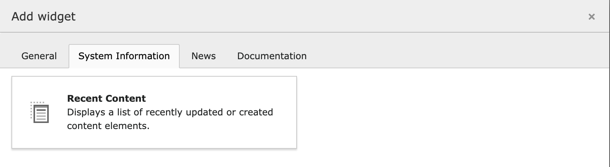
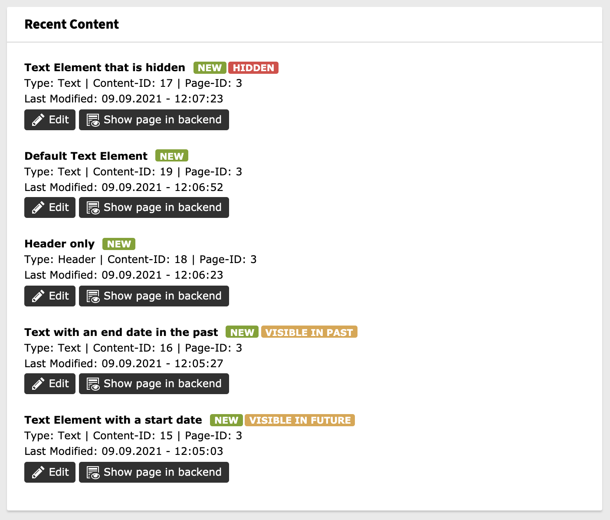

# Recent Content Widget

This TYPO3 extension provides a dashboard widget that displays a list of last modified or created content elements. It considers page access permissions to show only accessible content elements for the current backend user.





## Installation

```bash
composer require woit/si-recent-content-widget
```

or use the Extension Manager.

## Development

Run the unit tests (standalone checkout of the extension):

```bash
composer install
composer test:unit
```

## Credits

This extension was originally developed by [Epixskill](https://github.com/Epixskill/recent-content-widget)
as `epixskill/recent-content-widget` (extension key `recent_content_widget`).
Many thanks to Epixskill for creating it.

As the original extension is no longer maintained, it is continued by Siva
as `woit/si-recent-content-widget` (extension key `si_recent_content_widget`).

## License

GPL-2.0-or-later, see [LICENSE.txt](./LICENSE.txt).
